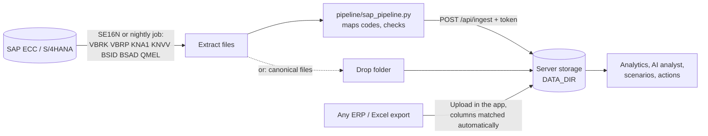

# SME Decision Intelligence

A decision-support application for small and medium-sized manufacturers and distributors. It turns operational data (orders, invoices, targets, customers, complaints) into **verified** metrics, explains what changed and why it might matter, tests "what-if" scenarios, and proposes follow-up actions that a person approves before anything is sent.

It is built to be **installed at a real company**: a setup wizard, CSV upload with automatic column matching (including SAP field names), an SAP pipeline script and ingest API for nightly loads, server storage with version restore, company settings (currency, fiscal year, business-rule thresholds), optional sign-in, and name masking before anything reaches the AI provider. The bundled sample company can be switched off.

The bundled sample is **Zarnab Tiles (Pvt) Ltd, a fictional Pakistani ceramic-tile manufacturer and distributor**. Every customer, product and number in it is synthetic.

> **Design principle:** numbers come from tested, deterministic analytics. The language model only explains numbers it is given, must cite them, and is checked automatically. Without an API key the app still works fully, in a clearly labelled demo mode.

---

## What it does

| Area | What a manager gets | Method |
|---|---|---|
| **Overview** | Eight headline KPIs with definitions, a 12-month trend, regions against target, and rule-based "needs attention" findings (what happened / why it matters / evidence / next step) | Descriptive analytics + transparent rules |
| **Sales & performance** | Trends by month or quarter, contribution to change by region/channel/category, product flags, unusual months, a baseline forecast with backtest | Descriptive + diagnostic analytics, modified z-score, baseline forecasting |
| **Customers & partners** | Revenue concentration (top-N, Pareto, HHI) and an explainable account-health score with the evidence for every deduction | Descriptive analytics + business rules |
| **Receivables** | Outstanding and overdue balances reconstructed *as of* any date, aging, overdue by region, accounts whose overdue grew most | As-of reconstruction from payment dates |
| **Complaints** | Open complaints by team and category, resolution time, product complaint spikes | Descriptive analytics + count-based spike rule |
| **Ask the analyst** | Plain-English answers that separate facts, possible explanations and recommended next steps, each citing an evidence ledger | Rule-based routing → analytics → LLM explanation → grounding check |
| **Scenarios** | Collect more overdue, change targets, change costs/discounts, shift product or channel mix | Explicit arithmetic on stated assumptions |
| **Actions** | Overdue alerts, follow-up tasks, complaint routing, management summary, sent to n8n only after named approval | Rules + optional n8n webhook |
| **Setup & data sources** | Three-step setup; CSV upload with automatic column matching (business or SAP names), editable and remembered; SAP pipeline, ingest API and drop folder; status, downloads, templates and one-click restore per dataset | Mapping + Zod validation; invalid loads never replace good data |
| **Settings** | Company name, currency, fiscal year start, volume unit, partner type, every business-rule threshold, AI name masking, integration status | Validated settings used by all analytics |
| **Management report** | Print-ready monthly summary of KPIs, attention items and receivables | Same verified analytics |

The sample data contains deliberate storylines the analytics should (and do) find: a Q3-2026 sales push into South/Central distributors that beats target while collections fall behind, slower payment by South distributors, a margin squeeze on one porcelain product, a shade-variation complaint spike on one GVT product, and two chronic slow payers.

## Architecture in one picture


More detail: [docs/ARCHITECTURE.md](docs/ARCHITECTURE.md).

## Getting company data in



| Route | Best for | Guide |
|---|---|---|
| **Upload CSVs** in *Set up your company* or *Data sources* | First look, pilots, companies without IT support | [Data dictionary](docs/DATA_DICTIONARY.md#importing-company-data) |
| **SAP pipeline** (`pipeline/sap_pipeline.py`) on a schedule | SAP ECC / S/4HANA customers | [SAP integration](docs/SAP_INTEGRATION.md) |
| **Ingest API** (`POST /api/ingest/{dataset}`) | ETL tools, n8n, Power Automate, Data Factory | [SAP integration §6](docs/SAP_INTEGRATION.md#6-ingest-api-reference) |
| **Drop folder** | SAP jobs that can write files to a share | [SAP integration §5](docs/SAP_INTEGRATION.md#5-alternative-drop-folder-no-script-on-the-client-side) |

Required: sales lines, customers, invoices. Recommended: payments (several per invoice, credit notes). Optional: targets, complaints.

## Install at a company (Docker)

```bash
cp .env.example .env      # set INGEST_TOKEN, BASIC_AUTH_*, ENABLE_SAMPLE_DATA=false, optionally ANTHROPIC_API_KEY
docker compose up -d --build
```

Then open the app, sign in and choose **Set up your company**. Full guide, HTTPS, backups and sizing: [docs/DEPLOYMENT.md](docs/DEPLOYMENT.md). Presenting it to a company: [docs/COMPANY_ROLLOUT.md](docs/COMPANY_ROLLOUT.md).

## Quick start (development)

Requirements: Node.js 20.9 or later, npm. Python 3.10+ with pandas only if you want to regenerate the data.

```bash
npm install
npm run dev            # http://localhost:3000
```

Without company data the app offers the setup wizard and the sample company. To enable live AI explanations:

```bash
cp .env.example .env.local
# edit .env.local and set ANTHROPIC_API_KEY=...
npm run dev
```

### Scripts

| Command | What it does |
|---|---|
| `npm run dev` | Development server |
| `npm run build` / `npm start` | Production build and server |
| `npm test` | Unit, integration and evaluation tests (Vitest) |
| `npm run typecheck` | Strict TypeScript check |
| `npm run eval` | AI analyst evaluation set in demo mode → `evals/results-demo.md` |
| `npm run eval:live` | Same evaluation against the live model (needs `ANTHROPIC_API_KEY`) → `evals/results-live.md` |
| `npm run data:generate` | Regenerate the synthetic CSVs (seeded, reproducible) |
| `npm run data:reference` | Recompute the independent pandas reference KPIs used by the tests |

## Environment variables

All optional. The app is fully usable with none of them; a company server normally sets the second group.

| Variable | Purpose | Default |
|---|---|---|
| `ANTHROPIC_API_KEY` | Enables live AI explanations on the Ask page. Server-side only. | not set → demo mode |
| `ANTHROPIC_MODEL` | Model used for explanations | `claude-sonnet-5-5` |
| `LLM_TIMEOUT_MS` | Provider timeout | `45000` |
| `N8N_WEBHOOK_URL` | Receives human-approved actions | not set → actions are reported as "not sent" |
| `N8N_WEBHOOK_SECRET` | Sent as `x-webhook-secret` so n8n can reject other callers | not set |
| `DATA_DIR` | Server storage for company datasets, settings and the drop folder | `./.data` self-hosted; off on Vercel |
| `INGEST_TOKEN` | Bearer token for `/api/ingest/*` (pipelines) | not set → ingest off |
| `ENABLE_SAMPLE_DATA` | `false` removes the fictional sample company | `true` |
| `ALLOW_UI_UPLOADS` | `false` for pipeline-only deployments | `true` |
| `BASIC_AUTH_USER` / `BASIC_AUTH_PASSWORD` | Sign-in for all pages and APIs except ingest | not set → open |

## Repository layout

```
src/
  app/                      Next.js routes: pages, /api/ask, /api/actions, /api/status,
                            /api/data, /api/ingest, /api/settings
  middleware.ts             Optional sign-in
  components/               App shell, filters, charts, page views
  lib/
    data/                   CSV parser, column mapping, normalisation, Zod schemas,
                            validation, bundle loading
    settings.ts             Company settings and business-rule thresholds
    server/                 Server storage, ingest, rate limiter
    client/                 Browser storage (IndexedDB) for deployments without a server disk
    analytics/              Pure, tested analytics functions (no UI, no AI)
    ai/                     Router, evidence packets, prompt, Anthropic client,
                            demo explainer, grounding check, evaluation harness
    actions.ts              Workflow action proposals + approval schema
public/sample-data/         Synthetic CSVs (+ messy/ files for validation demos)
pipeline/                   SAP → canonical datasets pipeline (Python), config example
data/sap_sample/            Synthetic SAP-format extracts for testing the pipeline
data/example_exports/       Synthetic "real-looking" ERP exports for testing upload mapping
Dockerfile, docker-compose.yml  Self-hosted company deployment
scripts/                    Data generator, pandas reference KPIs, eval runner
tests/                      Vitest suites
evals/                      Question set, reference KPIs, evaluation reports
n8n/                        Importable example workflow
docs/                       Architecture, KPIs, data dictionary, deployment, security,
                            testing, demo script, business case, interview guide
```

## Testing and verification status

See [docs/TESTING_AND_EVALUATION.md](docs/TESTING_AND_EVALUATION.md) for the full description, including exactly what was and was not run during development.

In short: 182 tests across 11 suites cover KPI arithmetic on a hand-checkable fixture, filters, receivables aging, concentration, scenarios, CSV validation, health scoring, anomalies, forecasting, complaints, the AI router, evidence packets, the grounding check, the provider client (with a mocked HTTP layer), approval rules, a 14-question evaluation set, ERP export handling (column matching, dates, credit notes, part payments), server storage and ingest, and the SAP pipeline end to end. The core KPIs are cross-checked against an independent pandas implementation, and the SAP route reproduces them exactly from synthetic SAP extracts. Not yet done: real Vitest/`next build` runs (CI does these), a Docker build, and a run on a real SAP system.

## Documentation

- [Architecture and design decisions](docs/ARCHITECTURE.md)
- [KPI definitions](docs/KPI_DEFINITIONS.md)
- [Data dictionary and data-quality notes](docs/DATA_DICTIONARY.md)
- [Testing and evaluation](docs/TESTING_AND_EVALUATION.md)
- [Deployment: company server (Docker) or Vercel](docs/DEPLOYMENT.md)
- [Connecting SAP](docs/SAP_INTEGRATION.md)
- [Offering it to a manufacturer: pitch and pilot plan](docs/COMPANY_ROLLOUT.md)
- [Security and privacy](docs/SECURITY.md)
- [n8n workflow integration](docs/N8N.md)
- [Two-minute demo script](docs/DEMO_SCRIPT.md)
- [Business case](docs/BUSINESS_CASE.md)
- [Interview guide: technical architecture explanation](docs/INTERVIEW_GUIDE.md)

## Known limitations

- **Synthetic data only so far.** Results demonstrate the method, not real market behaviour. No accuracy or business-impact figures are claimed. The SAP pipeline has been tested on synthetic SAP-format extracts, not a live SAP system.
- **Unapplied cash** (payments on account not matched to an invoice) is not modelled.
- **Estimated costs.** Gross profit uses estimated standard costs per order line, not audited costs; freight and rebates are excluded.
- **Targets by region and month only.** Target attainment is hidden when a channel or product filter is active.
- **Rule-based routing.** The Ask page matches questions to analyses with keyword rules. Unusual phrasings can be misrouted; the page always shows which analyses ran.
- **Grounding check is a safety net, not proof.** It verifies that numbers match the evidence, not that every sentence is a sound interpretation.
- **Health score and thresholds are assumptions**, not a validated predictive model.
- **One company per installation; one shared sign-in.** No per-user accounts or roles yet; use the company SSO in front for wider rollouts. On Vercel there is no server storage, so data stays in each browser.
- **Rate limiting is per server instance**, adequate for a demo but not a security control at scale.

## Future improvements

- Single sign-on with roles (viewer / data manager / approver) and an audit log of approvals.
- Postgres storage for very large histories, and server-side evidence building.
- Dispatch and order-backlog tables (VBAK/VBAP, LIKP/LIPS) for open-order and delivery KPIs.
- LLM-assisted routing as a fallback when no rule matches, evaluated against the same question set.
- Customer segmentation (for example RFM clustering) once enough customers exist to evaluate it.
- Forecasts by region and product with prediction intervals, once 3+ years of history are available.
- Live evaluation runs in CI against a fixed model version, tracking grounding failures over time.

## Licence and data

Code: MIT. Data: synthetic, generated by `scripts/generate_synthetic_data.py`, `scripts/make_sap_extracts.py` and `scripts/make_example_exports.py`. No employer, customer or confidential data is in this repository; company data is stored only on the company's own server or browser and is git-ignored.
