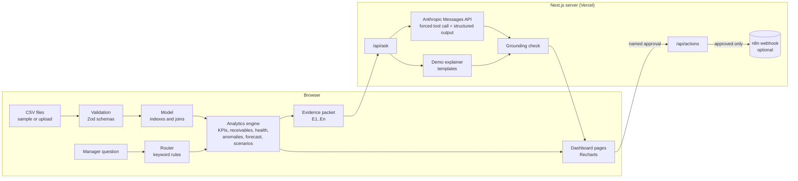

# SME Decision Intelligence

A decision-support application for small and medium-sized manufacturers and distributors. It turns operational data (orders, invoices, targets, customers, complaints) into **verified** metrics, explains what changed and why it might matter, tests "what-if" scenarios, and proposes follow-up actions that a person approves before anything is sent.

The demonstration business is **Zarnab Tiles (Pvt) Ltd, a fictional Pakistani ceramic-tile manufacturer and distributor**. Every customer, product and number in the bundled data is synthetic. Amounts are in Pakistani rupees (PKR).

> **Design principle:** numbers come from tested, deterministic analytics. The language model only explains numbers it is given, must cite them, and is checked automatically. Without an API key the app still works fully, in a clearly labelled demo mode.

---

## What it does

| Area | What a manager gets | Method |
|---|---|---|
| **Overview** | Eight headline KPIs with definitions, a 12-month trend, regions against target, and rule-based "needs attention" findings (what happened / why it matters / evidence / next step) | Descriptive analytics + transparent rules |
| **Sales & performance** | Trends by month or quarter, contribution to change by region/channel/category, product flags, unusual months, a baseline forecast with backtest | Descriptive + diagnostic analytics, modified z-score, baseline forecasting |
| **Customers & distributors** | Revenue concentration (top-N, Pareto, HHI) and an explainable account-health score with the evidence for every deduction | Descriptive analytics + business rules |
| **Receivables** | Outstanding and overdue balances reconstructed *as of* any date, aging, overdue by region, accounts whose overdue grew most | As-of reconstruction from payment dates |
| **Complaints** | Open complaints by team and category, resolution time, product complaint spikes | Descriptive analytics + count-based spike rule |
| **Ask the analyst** | Plain-English answers that separate facts, possible explanations and recommended next steps, each citing an evidence ledger | Rule-based routing → analytics → LLM explanation → grounding check |
| **Scenarios** | Collect more overdue, change targets, change costs/discounts, shift product or channel mix | Explicit arithmetic on stated assumptions |
| **Actions** | Overdue alerts, follow-up tasks, complaint routing, management summary, sent to n8n only after named approval | Rules + optional n8n webhook |
| **Data & validation** | Sample data or CSV upload, schema validation, row-level error messages, previews, cross-file checks | Zod schemas |

The sample data contains deliberate storylines the analytics should (and do) find: a Q3-2026 sales push into South/Central distributors that beats target while collections fall behind, slower payment by South distributors, a margin squeeze on one porcelain product, a shade-variation complaint spike on one GVT product, and two chronic slow payers.

## Architecture in one picture



More detail: [docs/ARCHITECTURE.md](docs/ARCHITECTURE.md).

## Quick start

Requirements: Node.js 20.9 or later, npm. Python 3.10+ with pandas only if you want to regenerate the data.

```bash
npm install
npm run dev            # http://localhost:3000
```

The app loads the bundled sample data automatically. To enable live AI explanations:

```bash
cp .env.example .env.local
# edit .env.local and set ANTHROPIC_API_KEY=...
npm run dev
```

### Scripts

| Command | What it does |
|---|---|
| `npm run dev` | Development server |
| `npm run build` / `npm start` | Production build and server |
| `npm test` | Unit, integration and evaluation tests (Vitest) |
| `npm run typecheck` | Strict TypeScript check |
| `npm run eval` | AI analyst evaluation set in demo mode → `evals/results-demo.md` |
| `npm run eval:live` | Same evaluation against the live model (needs `ANTHROPIC_API_KEY`) → `evals/results-live.md` |
| `npm run data:generate` | Regenerate the synthetic CSVs (seeded, reproducible) |
| `npm run data:reference` | Recompute the independent pandas reference KPIs used by the tests |

## Environment variables

All optional. The app is fully usable with none of them.

| Variable | Purpose | Default |
|---|---|---|
| `ANTHROPIC_API_KEY` | Enables live AI explanations on the Ask page. Server-side only. | not set → demo mode |
| `ANTHROPIC_MODEL` | Model used for explanations | `claude-sonnet-5-5` |
| `LLM_TIMEOUT_MS` | Provider timeout | `45000` |
| `N8N_WEBHOOK_URL` | Receives human-approved actions | not set → actions are reported as "not sent" |
| `N8N_WEBHOOK_SECRET` | Sent as `x-webhook-secret` so n8n can reject other callers | not set |

## Repository layout

```
src/
  app/                      Next.js routes (pages + /api/ask, /api/actions, /api/status)
  components/               App shell, filters, charts, page views
  lib/
    data/                   CSV parser, Zod schemas, validation, bundle loading
    analytics/              Pure, tested analytics functions (no UI, no AI)
    ai/                     Router, evidence packets, prompt, Anthropic client,
                            demo explainer, grounding check, evaluation harness
    actions.ts              Workflow action proposals + approval schema
    server/rateLimit.ts     Small in-memory rate limiter
public/sample-data/         Synthetic CSVs (+ messy/ files for validation demos)
scripts/                    Data generator, pandas reference KPIs, eval runner
tests/                      Vitest suites
evals/                      Question set, reference KPIs, evaluation reports
n8n/                        Importable example workflow
docs/                       Architecture, KPIs, data dictionary, deployment, security,
                            testing, demo script, business case, interview guide
```

## Testing and verification status

See [docs/TESTING_AND_EVALUATION.md](docs/TESTING_AND_EVALUATION.md) for the full description, including exactly what was and was not run during development.

In short: 150 tests across 8 suites cover KPI arithmetic on a hand-checkable fixture, filters, receivables aging, concentration, scenarios, CSV validation, health scoring, anomalies, forecasting, complaints, the AI router, evidence packets, the grounding check, the provider client (with a mocked HTTP layer), approval rules, and a 14-question evaluation set. The core KPIs are cross-checked against an independent pandas implementation.

## Documentation

- [Architecture and design decisions](docs/ARCHITECTURE.md)
- [KPI definitions](docs/KPI_DEFINITIONS.md)
- [Data dictionary and data-quality notes](docs/DATA_DICTIONARY.md)
- [Testing and evaluation](docs/TESTING_AND_EVALUATION.md)
- [Deploying to Vercel](docs/DEPLOYMENT.md)
- [Security and privacy](docs/SECURITY.md)
- [n8n workflow integration](docs/N8N.md)
- [Two-minute demo script](docs/DEMO_SCRIPT.md)
- [Business case](docs/BUSINESS_CASE.md)
- [Interview guide: technical architecture explanation](docs/INTERVIEW_GUIDE.md)

## Known limitations

- **Synthetic data.** Results demonstrate the method, not real market behaviour. No accuracy or business-impact figures are claimed.
- **One payment per invoice.** Real ERP data (for example SAP SD/FI) has multiple partial payments, credit notes and unapplied cash; the schema would need a payments table.
- **Estimated costs.** Gross profit uses estimated standard costs per order line, not audited costs; freight and rebates are excluded.
- **Targets by region and month only.** Target attainment is hidden when a channel or product filter is active.
- **Rule-based routing.** The Ask page matches questions to analyses with keyword rules. Unusual phrasings can be misrouted; the page always shows which analyses ran.
- **Grounding check is a safety net, not proof.** It verifies that numbers match the evidence, not that every sentence is a sound interpretation.
- **Health score and thresholds are assumptions**, not a validated predictive model.
- **Data lives in the browser session.** Uploads are not persisted; there are no user accounts or multi-tenant storage.
- **Rate limiting is per server instance**, adequate for a demo but not a security control at scale.

## Future improvements

- Payments, credit-note and dispatch tables to match ERP exports; a SAP SD/FI extract mapping.
- Persisted datasets per organisation (Postgres) with authentication and role-based access.
- LLM-assisted routing as a fallback when no rule matches, evaluated against the same question set.
- Customer segmentation (for example RFM clustering) once enough customers exist to evaluate it.
- Forecasts by region and product with prediction intervals, once 3+ years of history are available.
- Live evaluation runs in CI against a fixed model version, tracking grounding failures over time.

## Licence and data

Code: MIT. Data: synthetic, generated by `scripts/generate_synthetic_data.py`. No employer, customer or confidential data is used.
