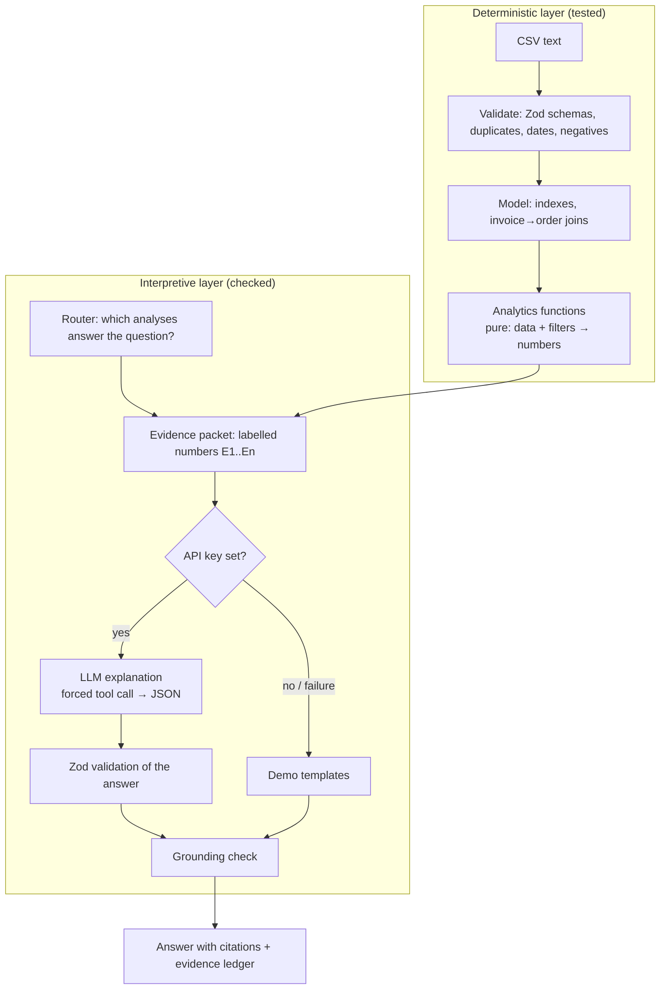

# Architecture and design decisions

## 1. The core idea: separate calculation from explanation

Language models are good at reading and writing, and unreliable at arithmetic over large tables. Business managers need the opposite guarantee: the numbers must be right, every time. So the system is split into two layers with a strict contract between them.

**Contract:** the LLM never sees raw rows and never computes a KPI. It receives an *evidence packet* — a list of items such as `E7 | Collection target attainment | 94.1%` — and must return a structured answer whose every fact cites evidence IDs. The server then checks every number in the answer against the packet.

## 2. Components

| Module | Responsibility | Why it is built this way |
|---|---|---|
| `lib/data/csv.ts` | RFC-4180 CSV parser | Small, no dependency, edge cases (quotes, BOM, CRLF) covered by tests |
| `lib/data/schemas.ts` | Zod schema per dataset | One source of truth for column names, types and rules; error messages a manager can read |
| `lib/data/validate.ts` | File-level and row-level validation, duplicate keys, cross-file checks | Bad rows are excluded *and reported*; a missing required column rejects the file |
| `lib/data/mapping.ts`, `normalise.ts` | Column matching (business and SAP names), dataset detection, number/date/code normalisation, defaults, credit-note signs | Real exports never match a fixed schema; mapping is explicit, editable and remembered |
| `lib/settings.ts` | Company profile, currency, fiscal year, partner type, business-rule thresholds | Every threshold the analytics use comes from one validated, editable place |
| `lib/server/storage.ts`, `ingest.ts`, `api/data`, `api/ingest` | Server storage with version restore, ingest API, drop folder | Company data is shared and updated by pipelines without anyone uploading files |
| `lib/ai/anonymise.ts` | Replace customer names in evidence before sending, restore afterwards | Customer names never need to leave the company |
| `pipeline/sap_pipeline.py` | SAP VBRK/VBRP/KNA1/KNVV/BSID/BSAD/QMEL → canonical CSVs → ingest API | Runs inside the company network, close to SAP |
| `lib/analytics/model.ts` | Indexes and joins, cached per dataset | Every analysis needs the same lookups; computing them once keeps functions simple |
| `lib/analytics/filters.ts` | Shared filter semantics | Sales use order date, collections use payment date, receivables are a snapshot; written down once so every page agrees |
| `lib/analytics/*.ts` | KPIs, receivables, trends, breakdowns, concentration, customers/health, products, anomalies, forecast, complaints, scenarios, diagnostics, insights | Pure functions, no UI and no AI, unit-tested |
| `lib/ai/router.ts` | Keyword rules → analyses; extracts region/period/percentage from the question | Predictable, free, testable; transparent to the user |
| `lib/ai/evidence.ts` | Runs the chosen analyses and labels each number | Defines exactly what the model may say |
| `lib/ai/prompt.ts`, `anthropic.ts` | System prompt, tool schema, HTTP client | Structured output by forcing a single tool call; key stays on the server |
| `lib/ai/grounding.ts` | Extracts numbers from the answer and matches them to evidence within display rounding | Catches invented or self-calculated numbers |
| `lib/ai/demo.ts` | Template explainer | The app is useful without a key, and never pretends an AI was called |
| `lib/ai/evals.ts` | Evaluation harness | Same code path for tests, the CLI and live runs |
| `lib/actions.ts`, `api/actions` | Action proposals, approval schema, n8n forwarding | Human approval is enforced by the server, not just the UI |

## 3. Key decisions and trade-offs

**TypeScript analytics instead of a Python service.** The brief allowed either. A separate Python/pandas service would add a second runtime, deployment and network hop for calculations that are simple aggregations. Keeping analytics in TypeScript means one deployable on Vercel and the same code runs in the browser, on the server and in tests. Python is still used where it adds value: the seeded data generator and an **independent pandas re-implementation of the core KPIs** that the TypeScript engine is tested against. Two implementations in two languages agreeing is stronger evidence than one implementation tested against itself.

**Analytics run in the browser.** Uploaded CSVs are processed locally, so raw business data never needs to reach the server. Only the compact evidence packet (labels and numbers) is sent to `/api/ask`. Trade-off: the server trusts the packet the browser sends; acceptable for a single-user analysis tool, and noted in [SECURITY.md](SECURITY.md).

**Receivables reconstructed "as of" a date.** Each invoice carries its payment date, so outstanding on any past date is `invoice amount − payments made on or before that date`. This makes the date filter correct for receivables (not just sales) and enables "overdue grew from X to Y" comparisons.

**Rule-based question routing.** An LLM router would handle more phrasings but would be less predictable, cost money per question and fail without a key. The keyword router is covered by the evaluation set; the UI shows which analyses ran. LLM routing is listed as a future improvement, to be adopted only if it beats the rules on the same evaluation set.

**Structured output via forced tool use.** The model is given one tool (`submit_analysis`) whose JSON schema is the answer format, and `tool_choice` forces it. The response is then validated again with Zod. Free-text parsing is avoided entirely.

**Grounding check with display-rounding tolerance.** "PKR 928.6M" must match 928,567,583; "115.4%" must match 115.364. The tolerance is half a unit of the last digit written, so the model cannot drift. Years, dates, IDs (C0006), tile sizes (60x120) and small integers ("top 5") are excluded. Causal words in a *fact* raise a warning, because causes belong in hypotheses.

**Simplest adequate method per question.**

| Question type | Method used | Not used, and why |
|---|---|---|
| How much, how many, what share | Descriptive aggregation | — |
| Where did the change come from | Contribution to change by segment | Causal models: the data cannot support causal claims |
| Is this month unusual | Modified z-score (median/MAD) vs prior 12 months | Mean/SD z-score is distorted by the outliers it is trying to find |
| Which accounts need attention | Transparent scoring rules | A trained classifier: no labelled outcomes (defaults, churn) exist to train or validate on |
| What could happen if | Arithmetic on stated assumptions | Simulation: adds false precision |
| What comes next | Four baseline forecasts compared on a rolling backtest | ARIMA/Prophet/ML: 33 months of history; complex models would fit noise. The best baseline is reported with its error |
| Complaint clusters | Count rule (≥3 and ≥3× normal rate in 60 days) | Statistical tests: counts are too small to be meaningful |

**Charts.** Recharts, one y-axis per chart (margin % is never put on a PKR axis), validated colour-blind-safe categorical colours (sales `#0096a3`, collections `#5b5fc7`), targets as dashed neutral reference lines, a single-hue ramp for aging severity, hover tooltips and legends.

**No vector database, no multi-agent system, no microservices.** The data is structured and small; retrieval over embeddings would add cost and failure modes without improving accuracy.

## 4. Request flow for "Why did sales increase while collections fell behind?"

1. `routeQuestion` matches `sales…collect` → analysis `sales_vs_collections`.
2. `buildEvidence` runs `computeKpis`, `diagnoseSalesVsCollections` (region gaps, payment delay by region × customer type, overdue movers, channel drivers) and labels ~25 numbers E1…E25.
3. The browser posts the packet to `/api/ask`. The server validates it (Zod, size limit, rate limit).
4. With a key: the Anthropic Messages API is called with the system prompt, the packet as text and the forced `submit_analysis` tool. Without a key: demo templates.
5. The answer is validated (Zod) and grounding-checked; the result is returned with `mode: "live" | "demo"` and any notices.
6. The UI shows the summary, facts with E-number citations, hypotheses with "how to verify", recommendations with priority, uncertainties, the full evidence ledger and the grounding badge.

## 5. Extending to another SME

The schemas describe generic B2B concepts (orders, customers, invoices, targets, complaints). To adapt to a different business:

1. Load its exports through **Set up your company**: columns are matched automatically and can be corrected per file; for SAP, use `pipeline/sap_pipeline.py` with a `config.json` of the company's codes ([SAP_INTEGRATION.md](SAP_INTEGRATION.md)).
2. Set currency, fiscal year, volume unit, partner type and the business-rule thresholds in **Settings** with the business.
3. Add domain-specific analyses as pure functions, register them in `ai/types.ts`, add router rules and evidence builders, and extend `evals/questions.json`.
