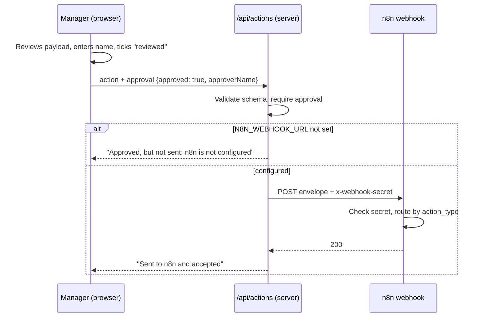

# n8n workflow integration (optional)

The app proposes actions; **a person approves each one**; only then is it posted to an n8n webhook that does the repetitive part (emails, tasks, routing). The app works fully without n8n.



## Actions

| Type | Proposed when | Default recipient |
|---|---|---|
| `overdue_alert` | A customer's overdue balance exceeds the threshold set on the Actions page (default PKR 10M) | Credit control |
| `follow_up_task` | An active account is in the "Needs attention" health band | Regional sales team |
| `complaint_routing` | An open Medium or High severity complaint | The complaint's owning team |
| `management_summary` | Always available for the selected period | Management team |

## Payload sent to n8n

```json
{
  "source": "sme-decision-intelligence",
  "sent_at": "2026-10-17T09:30:00.000Z",
  "action_id": "overdue_alert:C0006:2026-09-30",
  "action_type": "overdue_alert",
  "title": "Overdue alert: Rafiq Distributors",
  "recipient": "Credit control",
  "reason": "PKR 35.0M overdue (threshold PKR 10.0M); oldest invoice 61 days past due.",
  "approved_by": "Ayesha Khan",
  "approval_note": "",
  "payload": { "customer_id": "C0006", "overdue_pkr": 34960000, "as_of": "2026-09-30" }
}
```

`action_id` is deterministic, so n8n can de-duplicate repeated approvals.

## Setting it up

1. In n8n, **Import from file** → `n8n/sme-actions-workflow.json`.
2. Set an environment variable `SME_WEBHOOK_SECRET` in n8n (the workflow compares it with the `x-webhook-secret` header). If your n8n plan does not allow `$env` in expressions, replace that expression with the secret value or use the Webhook node's Header Auth option.
3. Configure SMTP credentials on the email nodes and replace the `example.com` addresses. Replace the "Create follow-up task" no-op with your task tool (Asana, Jira, Google Sheets, ClickUp...).
4. Activate the workflow and copy the **production** webhook URL.
5. In the app's environment: `N8N_WEBHOOK_URL=<that URL>` and `N8N_WEBHOOK_SECRET=<same secret>`. Restart or redeploy.
6. On the Actions page, approve the management summary first as a safe end-to-end test.

The workflow file is a starting template written against n8n's long-standing v1 node formats. It has not been run against a live n8n instance in this project; n8n may upgrade node versions on import, so check each node after importing.
